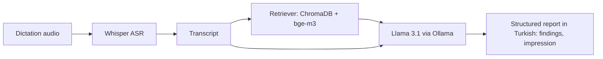

<!--
  Profile README for github.com/Tugaytalha.
  Blocks between AUTO:<NAME>:START and AUTO:<NAME>:END are rewritten daily by
  .github/workflows/daily.yml (scripts/update_readme.py). Do not edit them by hand.
-->

<picture>
  <source media="(prefers-color-scheme: dark)" srcset="https://raw.githubusercontent.com/Tugaytalha/Tugaytalha/main/assets/banner-dark.svg">
  <source media="(prefers-color-scheme: light)" srcset="https://raw.githubusercontent.com/Tugaytalha/Tugaytalha/main/assets/banner-light.svg">
  
</picture>

**I build self-hosted LLM systems end to end: GPU sizing and serving, retrieval, agents and voice.**

I like the part of AI work that happens after the demo: checking that a model fits on the GPUs you actually have, measuring how it behaves under load, and connecting it to retrieval, tools and speech so people can use it. Much of what I build is Turkish-first and runs on local or self-hosted models.

- **Day job:** AI Engineer at AlbarakaTech. I work directly with business teams as customers, turn their needs into on-prem LLM and RAG platforms for banking, deliver them end to end and refine them with their feedback.
- **Focus in 2026:** vLLM capacity planning, MCP tooling for teams, and evaluation loops for agents.
- **Previously:** Huawei Cloud intern (summer 2024). B.Sc. in Computer Engineering, Gebze Technical University (2025).

🏆 3rd place, Cloud track: [Huawei ICT Competition 2023–2024 Europe](https://www.gtu.edu.tr/en/icerik/8/21845/display.aspx) 
🥇 1st in the "A World Away: Hunting for Exoplanets with AI" challenge, 4th overall: [NASA Space Apps Challenge 2025 Istanbul](https://www.spaceappschallenge.org/2025/find-a-team/svoria/)

> [!NOTE]
> Much of my work happens in private repositories, so the public repos below show only part of it. <!-- AUTO:CONTRIB:START -->In 2026 so far: **1,697** contributions, **82%** of them in private repositories.<!-- AUTO:CONTRIB:END -->

## Featured projects

<table>
<tr>
<td width="50%" valign="top">

<kbd>Serving</kbd>

**[vllm-vram-calculator](https://github.com/Tugaytalha/vllm-vram-calculator)** 
Tells you whether a model fits on your GPUs, and for how many concurrent users, before you deploy it. Estimates weights, KV cache (GQA/MHA) and activation memory from FP32 down to INT4, AWQ and GPTQ, including tensor-parallel splits. Web UI and REST API.

Python · FastAPI · pytest · MIT

</td>
<td width="50%" valign="top">

<kbd>Serving</kbd>

**[vllm-load-test](https://github.com/Tugaytalha/vllm-load-test)** 
Measures what the deployed server actually does. Runs an async step-sweep load against an OpenAI-compatible vLLM endpoint and records streaming time-to-first-token, end-to-end and inter-token latency, vLLM Prometheus metrics and nvidia-smi GPU telemetry, with per-step summaries and a Markdown report.

Python · asyncio · Prometheus · MIT

</td>
</tr>
<tr>
<td width="50%" valign="top">

<kbd>Agents &amp; tools</kbd>

**[models-mcp](https://github.com/Tugaytalha/models-mcp)** 
One catalog of a team's model deployments (vLLM LLMs, embedding and reranker models, custom services) that GitHub Copilot can query over MCP. A single FastAPI app serves the MCP endpoint, a REST API and a read-only web catalog. Schema migrations run on startup under a PostgreSQL advisory lock, so replicas can start together.

FastAPI · MCP · PostgreSQL · Alembic · Docker · Kubernetes

</td>
<td width="50%" valign="top">

<kbd>Agents &amp; tools</kbd>

**[The-Builder](https://github.com/Tugaytalha/The-Builder)** 
Our entry for the Freya × YC "Build the Builder" hackathon (2026): give it a bank's brief and tool API, and it builds a working Freya phone agent with the Claude Agent SDK. My part: the persona-simulation evaluation harness (LLM and scripted callers, LLM judge) and the final-case test runs. The pass rate went from 6/50 to 27/50 between builds. Built with [@resitaydin](https://github.com/resitaydin).

Python · Claude Agent SDK · pytest

</td>
</tr>
<tr>
<td width="50%" valign="top">

<kbd>Speech + RAG</kbd>

**[InsightBridge](https://github.com/Tugaytalha/InsightBridge)** · [thesis (PDF)](https://github.com/Tugaytalha/InsightBridge/blob/main/InsightBridge_TugayTalhaIcen.pdf) 
My B.Sc. graduation thesis at GTÜ. Whisper transcribes a radiologist's dictation, a domain RAG (ChromaDB + bge-m3) retrieves reference material, and Llama 3.1 via Ollama drafts a structured report in Turkish with findings and impression sections. Includes an evaluation framework.

Whisper · ChromaDB · Ollama · LangChain · Gradio · Apache-2.0

</td>
<td width="50%" valign="top">

<kbd>Speech</kbd>

**[NarraPhon](https://github.com/Tugaytalha/NarraPhon)** 
Turns a PowerPoint deck's speaker notes (or TXT files, ZIP archives and plain text) into a narrated video with subtitles: StyleTTS2 speech with voice cloning, Whisper subtitles and a Gradio UI. Built on [StyleTTS2](https://github.com/yl4579/StyleTTS2).

PyTorch · StyleTTS2 · Whisper · Gradio · MIT

</td>
</tr>
</table>

  <picture>
    <source media="(prefers-color-scheme: dark)" srcset="https://raw.githubusercontent.com/Tugaytalha/Tugaytalha/main/assets/screenshots/vllm-vram-calculator-dark.png">
    <source media="(prefers-color-scheme: light)" srcset="https://raw.githubusercontent.com/Tugaytalha/Tugaytalha/main/assets/screenshots/vllm-vram-calculator-light.png">
    
  </picture>
   vllm-vram-calculator: Gemma 2 9B in FP16 on one RTX 4090 needs 22.35 GB of 24 GB.

<b>How InsightBridge works</b>

<b>More projects</b>

| Project | What it is |
| :-- | :-- |
| Exoplanet explorer | NASA Space Apps Challenge 2025 with team Svoria: a Kepler KOI disposition classifier (XGBoost, AutoML) with a Gemini + FAISS question-answering endpoint, served with FastAPI. |
| Solar production forecasting (Sun-Farm) | Huawei R&D Coding Marathon 2024 finalist, built with [@umit-sen](https://github.com/umit-sen) and Oğuzhan Kaya: irradiation and energy-output forecasts for a location, with a 30-year production and payback estimate. H2O AutoML, XGBoost, Flask, Docker. |
| MosaicMind | Team project: federated learning (FedAvg in C++/LibTorch) and image captioning across Raspberry Pi nodes, with web and Flutter clients. My part: the federated-learning component and the web dashboard. |
| LSTM vs. Liquid Time-Constant networks | Remaining-useful-life prediction on NASA's CMAPSS turbofan dataset. |
| [Wooden calendar puzzle solver](https://github.com/Tugaytalha/Wooden-Calendar-Puzzle-Solver) | From brute force to bitmask + memoised DP; it solves every date of the year, worst case under a second. It also draws the board at the bottom of this page. |
| Dues ledger | Side project for a relative's residential complex: bank-statement import and de-duplication, explainable rule-based payment matching, and optional LLM suggestions that are never auto-approved. FastAPI, React, TypeScript. |
| [Qunzia](https://qunzia.com) | Side project: a bilingual (Arabic/English) services directory and booking marketplace for the GCC. |

## Milestones

| When | What |
| :-- | :-- |
| 2026 | Freya × YC "Build the Builder" hackathon: [The-Builder](https://github.com/Tugaytalha/The-Builder), built with [@resitaydin](https://github.com/resitaydin) |
| 2025 | NASA Space Apps Challenge, Istanbul: 1st in the "A World Away: Hunting for Exoplanets with AI" challenge, 4th overall (team Svoria) |
| 2025 | B.Sc. Computer Engineering, Gebze Technical University. Thesis: [InsightBridge](https://github.com/Tugaytalha/InsightBridge) |
| 2025 | Docs fix merged into LangChain ([#29329](https://github.com/langchain-ai/langchain/pull/29329)) |
| 2024 | Huawei R&D Coding Marathon: finalist (Sun-Farm) |
| 2024 | Huawei Cloud intern (summer) · HSD Türkiye ambassador · [article on Huawei Developers](https://medium.com/huawei-developers/%EF%B8%8Fdeploy-like-a-pro-golang-deployment-and-huawei-codearts-integration-a-comprehensive-step-by-9b5be8120906) |
| 2024 | Huawei ICT Competition 2023–2024, Europe: 3rd place, Cloud track |
| 2023–24 | YZUP AI specialization program · NLP project under HAVELSAN mentorship |

## Tech

<picture>
  <source media="(prefers-color-scheme: dark)" srcset="https://raw.githubusercontent.com/Tugaytalha/Tugaytalha/main/assets/icons/stack-dark.svg">
  <source media="(prefers-color-scheme: light)" srcset="https://raw.githubusercontent.com/Tugaytalha/Tugaytalha/main/assets/icons/stack-light.svg">
  
</picture>

**LLM & speech:** vLLM · Ollama · LangChain · ChromaDB · FAISS · Hugging Face Transformers · sentence-transformers · Whisper · StyleTTS2 · MCP · Claude Agent SDK

## Activity

<picture>
  <source media="(prefers-color-scheme: dark)" srcset="https://raw.githubusercontent.com/Tugaytalha/Tugaytalha/main/profile-3d-contrib/profile-3d-dark.svg">
  <source media="(prefers-color-scheme: light)" srcset="https://raw.githubusercontent.com/Tugaytalha/Tugaytalha/main/profile-3d-contrib/profile-3d-light.svg">
  
</picture>

Contributions per year

<!-- AUTO:YEARLY:START -->

| Year | Contributions |
| :-- | --: |
| 2026 (to 22 Oct) | 1,697 |
| 2025 | 773 |
| 2024 | 345 |

<!-- AUTO:YEARLY:END -->

Counts come from the GitHub contribution calendar.

GitHub stats

 
<picture>
  <source media="(prefers-color-scheme: dark)" srcset="https://raw.githubusercontent.com/Tugaytalha/Tugaytalha/main/assets/generated/stats-dark.svg">
  <source media="(prefers-color-scheme: light)" srcset="https://raw.githubusercontent.com/Tugaytalha/Tugaytalha/main/assets/generated/stats-light.svg">
  
</picture>

<!-- AUTO:COMMITTERS:START --><!-- AUTO:COMMITTERS:END --> 

## Today's date, solved

  <picture>
    <source media="(prefers-color-scheme: dark)" srcset="https://raw.githubusercontent.com/Tugaytalha/Tugaytalha/main/assets/generated/puzzle-dark.svg">
    <source media="(prefers-color-scheme: light)" srcset="https://raw.githubusercontent.com/Tugaytalha/Tugaytalha/main/assets/generated/puzzle-light.svg">
    
  </picture>

Every night a GitHub Action runs my <a href="https://github.com/Tugaytalha/Wooden-Calendar-Puzzle-Solver">wooden-calendar solver</a> for the new date. Ten pieces must cover every cell except today's day, month and weekday (labels in Turkish).

---

Happy to talk about self-hosted LLM serving, Turkish-language RAG and voice agents.

  <a href="https://www.linkedin.com/in/tugay-talha-i%C3%A7en-4793461a2/">LinkedIn</a> ·
  <a href="mailto:mukoicen@gmail.com">Email</a> ·
  <a href="https://huggingface.co/Tugaytalha">Hugging Face</a> ·
  <a href="https://www.hackerrank.com/tugaytalha">HackerRank</a> ·
  <a href="https://medium.com/@mukoicen">Writing</a>

The banner, icons, calendar, stats and puzzle are files in this repo, refreshed by <a href="https://github.com/Tugaytalha/Tugaytalha/blob/main/.github/workflows/daily.yml">the daily workflow</a>. Last refresh: <!-- AUTO:UPDATED:START -->22 Oct 2026<!-- AUTO:UPDATED:END -->.

